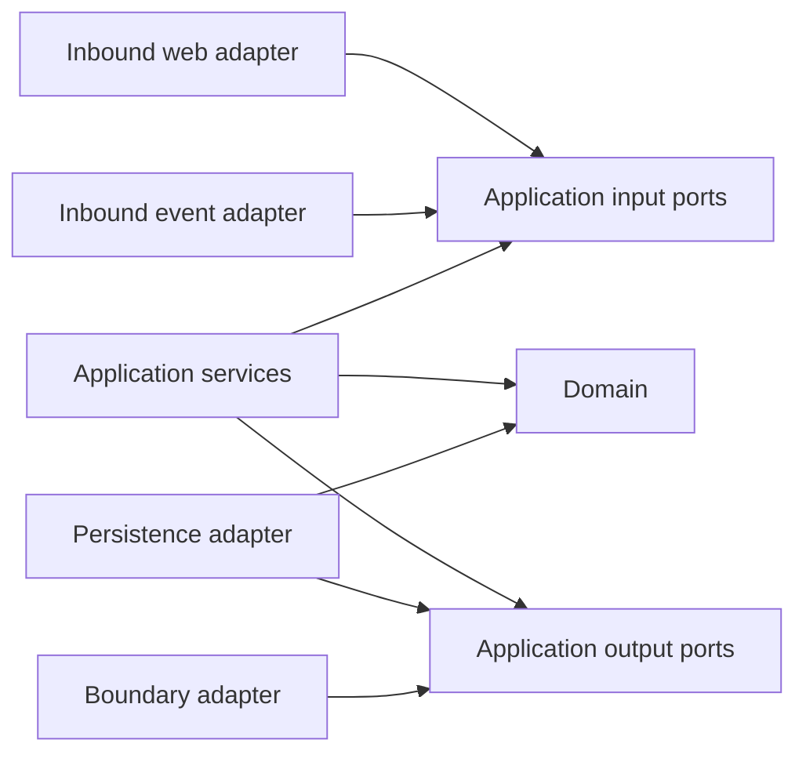

# Meridian Dependency Rules and Architecture Enforcement

## Purpose and Document Authority

This document defines the legal Java source dependencies for the `meridian-platform` modular monolith and how Meridian enforces them.

| Document | Authority |
|---|---|
| `MER-ARCH-001-bounded-contexts.md` | Business ownership, source-of-truth boundaries, public capabilities, and context collaboration |
| `MER-ARCH-002-project-structure.md` | Source layout, feature-module structure, and package placement |
| `MER-ARCH-003-dependency-rules.md` | Legal compile-time dependencies, public module surfaces, adapters, and architecture enforcement |
| `MER-ARCH-006-api-request-flow-and-dependencies.md` | Concrete request flows, transactions, retries, locks, and runtime security behavior |

Each bounded context is represented by a feature module as defined in `MER-ARCH-002`. `shared` is a technical package, not a feature module or bounded context.

This document translates the ownership rules in `MER-ARCH-001` into source-code constraints. It does not redefine business ownership or workflow state.

Implementation progress and temporary conformance gaps belong in the project roadmap and follow-up register. Executable architecture tests remain authoritative for rules described as automatically enforced.

---

## 1. Dependency Direction

> **Dependencies point inward.**

The arrows below show allowed source dependencies.



The domain owns business state and policy. The application layer implements use cases, coordinates transactions, and owns its input and output ports. Infrastructure handles protocols, persistence, providers, and cross-module translation.

Framework convenience must not reverse this direction.

---

## 2. Layer Dependency Rules

| From | May depend on | Must not depend on |
|---|---|---|
| **Domain** | Java, its own domain types, and stable shared abstractions | Spring, JPA, application, infrastructure, boundary DTOs, or foreign feature modules |
| **Application** | Its own domain, input and output ports, application DTOs, stable shared application abstractions, and explicitly published foreign contracts when the dependency is intentional | Infrastructure, JPA entities, web adapters, concrete security or JWT implementation, or foreign internal application types |
| **Inbound web adapter** | Application input ports and DTOs, HTTP and authorization annotations, and shared web abstractions | Repositories, output ports, JPA entities, domain services, or foreign internals |
| **Inbound event adapter** | Published event schemas, application input ports, and event-framework types | Repositories, direct aggregate mutation, or foreign infrastructure |
| **Persistence adapter** | Its module's output ports and domain models, JPA or JDBC, and persistence mapping | Controllers, foreign repositories or entities, or workflow orchestration |
| **Boundary adapter** | A consumer-owned private output port and the provider's published application contract | Provider domain models, repositories, JPA entities, or internal services |
| **Inbound SPI adapter** | Its designated consumer-owned published SPI and own provider input contracts/results | Repositories, output ports, persistence entities, application implementations, or business orchestration |
| **Shared kernel** | Java and stable cross-cutting technical abstractions | Any feature module |

### Domain

Domain code remains pure Java. It must not perform HTTP, database, storage, messaging, authentication-context, or framework operations.

### Application

Application services implement input ports and own use-case orchestration, transaction boundaries, idempotency coordination, and policy selection. They may use `CurrentUserProvider` or explicit actor facts, but not Spring Security principals, JWT claims, or Identity infrastructure types.

### Adapters

Controllers and event listeners invoke application input ports. Persistence and ordinary boundary adapters implement private output ports. Only designated provider inbound adapters implement the published consumer SPIs catalogued in Section 4. Adapters translate protocols and records; they must not decide business state transitions.

---

## 3. Module Public Surfaces

A feature module publishes only the contracts required for collaboration.

Published surfaces may include:

- application input ports intended for another module;
- purpose-limited application contract records;
- business-event schemas;
- the finite consumer-owned SPIs and support types catalogued in Section 4;
- identifiers and closed value representations intended for collaboration.

The following remain internal unless an owning architecture decision explicitly publishes them:

- domain models and services;
- repositories and output ports;
- application service implementations;
- persistence entities and adapters;
- controllers and web DTOs;
- configuration and concrete security implementation;
- storage keys, encryption envelopes, and provider-specific types.

Java `public` visibility alone does not make a type a cross-module contract. A published contract must be deliberate, stable, and placed in a package intended for collaboration.

Spring Modulith named interfaces, package visibility, or ArchUnit rules are possible enforcement mechanisms. Their presence must not be inferred from dependencies or Java visibility; Section 9 defines the executable coverage boundary.

---

## 4. Cross-Module Contracts and Adapters

Business collaboration, runtime calls, source dependencies, and persistence ownership describe different relationships.

| Relationship | Meaning |
|---|---|
| **Business collaboration** | Which context needs a capability or fact; defined in `MER-ARCH-001` |
| **Runtime invocation** | Which component calls a contract during execution |
| **Compile-time dependency** | Which package imports another package |
| **Persistence ownership** | Which context owns and mutates the data |

A runtime call does not grant permission to import the provider's domain or persistence model.

### Synchronous Collaboration

The preferred synchronous boundary is:

```text
consumer application
    → consumer-owned output port
    → consumer boundary adapter
    → provider public application contract
    → provider application
```

A boundary adapter may translate identifiers, immutable records, errors, redaction, and bounded sensitive values. It must not expose provider aggregates, call provider repositories, retain unrestricted evidence, bypass provider checks, or write provider-owned persistence.

### Published Consumer SPI Exception (Design S)

The ordinary provider-public-contract pattern remains the default. The following finite exception reverses the contract dependency while retaining business ownership:

```text
Runtime: consumer application → consumer published SPI → provider inbound adapter
         → provider-owned input port → provider application
Java:    provider infrastructure → consumer published SPI
```

An SPI replaces its corresponding private output port. It must not extend or wrap that port, retain a consumer forwarding adapter, or introduce a second active implementation. Constructor injection resolves one designated implementation without qualifiers, profiles, fallback beans, or `@Primary`.

Publication requires an explicit purpose, consumer owner, designated provider implementer, operations, and approved support-type closure. SPI signatures and support types may use only JDK types, their explicitly published immutable facts, and approved shared technical contracts. Nested records, generic arguments, inheritance, and all transitive support types belong to that closure; foreign domain, internal application, persistence, web, and infrastructure types are forbidden. Java visibility, an `application.spi` package, or an `Spi` suffix grants no publication permission.

The catalogue authorizes exactly nine interfaces. Approval owns the first three under `approval.application.spi.loan`; Document owns five under `document.application.spi.loan` and one under `document.application.spi.identity`. Named support types below belong to their owning SPI surface; all other support types require an explicit publication decision.

| Published SPI | Purpose / operations | Approved support types | Designated provider inbound adapter |
|---|---|---|---|
| `ApprovalLoanCaseSpi` | Loan case and decision queue: `findCase`, `findDecisionQueue` | Nested `CaseSnapshot`, `DocumentReadinessSnapshot`, `ProductReadinessSnapshot`, `ReviewCycleSnapshot`, `CorrectionOptionSnapshot`, `QueuePageSnapshot`, `QueueItemSnapshot` | `loan.infrastructure.adapter.in.approval.ApprovalLoanCaseAdapter` |
| `ApprovalLoanReviewCycleSpi` | Active cycle identity and assignment: `findActiveReviewCycle` | Nested `ActiveReviewCycleSnapshot` | `loan.infrastructure.adapter.in.approval.ApprovalLoanReviewCycleAdapter` |
| `ApprovalLoanReviewHistorySpi` | Application identity/status and ordered cycles: `findHistory` | Nested `HistorySnapshot`; published `ApprovalLoanCaseSpi.ReviewCycleSnapshot` | `loan.infrastructure.adapter.in.approval.ApprovalLoanReviewHistoryAdapter` |
| `LoanDocumentWorkflowSpi` | Separate workflow read and lock: `find`, `lock` | `LoanDocumentWorkflowSnapshot` | `loan.infrastructure.adapter.in.document.LoanDocumentWorkflowAdapter` |
| `LoanDocumentCorrectionSpi` | Exact item/version upload authority: `authorizeCustomerUpload`, `authorizeStaffUpload` | Closed `StaffUploadAuthority` | `loan.infrastructure.adapter.in.document.LoanDocumentCorrectionAdapter` |
| `LoanDocumentReviewCorrectionSpi` | Replacement continuation: `requestCustomerReplacement` | Shared technical `BusinessOperationContext`; no business support record | `loan.infrastructure.adapter.in.document.LoanDocumentReviewCorrectionAdapter` |
| `LoanAssistedOriginationSpi` | Intake read/mutation and identity-verification authority: `authorizeRead`, `authorizeMutation`, `authorizeIdentityVerification` | `AuthorizedIntake` | `loan.infrastructure.adapter.in.document.AssistedOriginationEvidenceAuthorizationAdapter` |
| `LoanAssistedActionAuthorizationSpi` | Exact signed-action targets: `authorizeOfferEvidence`, `authorizeContractEvidence`, `authorizeCancellationEvidence` | No support record | `loan.infrastructure.adapter.in.document.AssistedActionEvidenceAuthorizationAdapter` |
| `DocumentStaffActorDirectorySpi` | Finite Staff summary lookup: `findByUserIds` | `StaffActorSummary` | `identity.infrastructure.adapter.in.document.DocumentStaffActorDirectoryAdapter` |

Only each designated provider inbound adapter may implement its SPI. It translates and delegates to provider-owned input interfaces and results; it must not inject repositories, output ports, entities, or service implementations. Provider domain/application code must not depend on the consumer's SPI or return its records. Provider inputs used only by own inbound adapters remain internal; they do not become cross-module APIs by placement under `application.port.in`.

Newly extracted provider query helpers and inbound adapters introduce no transaction annotation or independent transaction boundary. Existing callers retain transaction, isolation, authorization, locking, synchronous continuation, and rollback ownership. Approval retains recommendation/decision policy, case authorization, maker-checker enforcement, correction intent validation, and history composition. Loan supplies its authoritative application, assignment, verification, readiness, correction-option, and cycle facts.

### Cross-Module Source Rules

1. Domain and application packages must not depend on another feature's domain, infrastructure, persistence, or web packages.
2. Foreign application types are legal only when they are explicitly published contracts or event schemas.
3. Cross-context references use stable identifiers and purpose-limited immutable facts, not aggregate object graphs.
4. Each module owns its repositories, JPA entities, persistence mappings, and tables.
5. Bidirectional collaboration uses separate explicit contracts or events. All eight feature modules must form an acyclic Java dependency graph. Every edge counts, including published inputs, support records, SPIs, events, infrastructure bindings, signatures, inheritance, and fully qualified references. Public-contract legality never exempts an edge from cycle detection.
6. Repository ports return domain objects or explicit application records, never REST DTOs.

---

## 5. Business Events and Reliability

Business events are published schemas representing facts that occurred or outcomes another context must apply.

Event schemas should contain stable identifiers, closed action or reason values, timestamps, correlation data, and purpose-limited immutable facts. They must not contain JPA entities, aggregate graphs, unrestricted evidence, secrets, encryption internals, or mutable shared collections.

An event listener is an inbound adapter. It translates the event into an application command and invokes an input port; it must not write repositories directly.

Meridian uses one of two explicit reliability models:

- **Synchronous transaction participation** when downstream failure must roll back the originating outcome.
- **Durable asynchronous delivery** when processing is decoupled and retry, idempotency, ordering, reconciliation, and replay are defined.

Business-critical coordination must not rely on fire-and-forget delivery.

Audit consumes published facts without becoming the authority over the workflow that produced them. Notification's supported security emails instead use purpose-specific public contracts after Identity commits. Secret-bearing delivery inputs must remain transient, outside durable event schemas. Runtime timing and rollback consequences belong in [MER-ARCH-006](MER-ARCH-006-api-request-flow-and-dependencies.md).

---

## 6. Code-Level Boundary Rules

### Persistence Isolation

Cross-context references may use stable identifiers, immutable snapshots, purpose-limited records, and published events.

A module must not:

- import a foreign JPA entity;
- call a foreign repository or persistence adapter;
- share one persistence entity with another module;
- use a cross-context aggregate object graph;
- treat a direct cross-context join as application integration;
- write another context's tables.

A database foreign key may protect integrity without transferring aggregate ownership.

### Shared Kernel

`shared` must not contain feature behavior or depend on `identity`, `customer`, `partner`, `loan`, `approval`, `document`, `audit`, or `notification`. `MER-ARCH-001` and `MER-ARCH-002` define its permitted responsibility and placement.

### Security Isolation

Concrete Spring Security and JWT code belongs to Identity infrastructure.

Feature domain and application code may use `AuthenticatedUser`, `CurrentUserProvider`, or explicit actor facts. They must not depend on security-context access, JWT libraries, Identity principals, filters, token services, or security configuration.

Authorization permits an actor to attempt a capability. The owning context still enforces resource ownership and business invariants.

### Product and Supporting Capabilities

Product-specific lending code remains inside `loan`. Top-level feature modules for Salary Advance, Unsecured Consumer Loan, or Collateral Loan are forbidden.

Document application code owns OCR job creation through Document ports and persistence adapters. The external Python worker keeps Google Document AI behind its provider-neutral `OcrProvider` boundary. Loan may consume Document's published readiness contract but must not import, call, or persist an OCR provider or OCR result directly.

Audit consumes published event schemas through its inbound adapter. Notification accepts its supported security messages through public application contracts and keeps transport behind its own output port. Neither may import producer internals or command the originating workflow.

`MER-ARCH-001` remains authoritative for the underlying business ownership.

---

## 7. Security and Privacy at Boundaries

Public contracts, event schemas, errors, audit payloads, and logs follow least disclosure.

They may carry identifiers, masked values, closed statuses, reason codes, and authorized purpose-limited facts.

They must not expose:

- unrestricted national identifiers or bank-account numbers;
- passwords, tokens, secrets, or keys;
- persistence entities;
- encryption or storage internals;
- document evidence outside an authorized Document boundary.

Detailed HTTP disclosure, sensitive-value handling, and request-specific security rules belong in API, security, and request-flow documentation.

---

## 8. Architecture Rule Catalogue

| Rule ID | Normative rule | Intended enforcement |
|---|---|---|
| `LAYER-DOMAIN-001` | Domain must not depend on Spring, JPA, application, or infrastructure | ArchUnit |
| `LAYER-APPLICATION-001` | Application must not depend on infrastructure | ArchUnit |
| `SECURITY-ISOLATION-001` | Domain and application must not depend on concrete security, JWT, or Identity security implementation | ArchUnit |
| `SHARED-001` | Shared must not depend on feature modules | ArchUnit |
| `WEB-BOUNDARY-001` | Web adapters must not depend on repositories, entities, domain services, or output ports | ArchUnit |
| `EVENT-BOUNDARY-001` | Event listeners enter through input ports and avoid direct persistence | ArchUnit plus review |
| `MODULE-PERSISTENCE-001` | Modules must not import or mutate foreign persistence models | ArchUnit plus review |
| `MODULE-PUBLIC-001` | Cross-module imports use explicit published contracts or events | Spring Modulith or ArchUnit |
| `MODULE-CYCLE-001` | Direct feature-module dependency cycles are forbidden | Spring Modulith or ArchUnit slices |
| `PRODUCT-BOUNDARY-001` | Product-specific lending behavior remains under Loan | ArchUnit package rules |
| `EVENT-RELIABILITY-001` | Critical event coordination defines failure and recovery semantics | Integration tests |
| `PRIVACY-BOUNDARY-001` | Public boundaries do not disclose unrestricted PII or secrets | Serialization, security, and logging tests |

---

## 9. Enforcement and Evolution

Mechanically checkable rules belong in `ArchitectureRulesTest` or focused architecture-test classes and run in the normal Maven verification lifecycle.

The catalogue's intended enforcement column is a design requirement, not a coverage claim. `ArchitectureRulesTest` mechanically checks:

- domain isolation from Spring, JPA, application, and infrastructure;
- application isolation from infrastructure;
- domain/application isolation from Spring Security, JWT libraries, and Identity security implementation;
- `shared` independence from feature modules;
- Identity domain/application isolation from Customer, Notification, and mail transport;
- Notification application isolation from mail transport;
- inbound web-adapter and input-port isolation from output ports, plus web/event-adapter isolation from repositories, persistence entities, domain services, and application service implementations;
- foreign domain/internal application vocabulary isolation, retaining explicitly published Partner support facts and the clearable Customer bank-account carrier;
- private Approval and Loan correction policies and the explicit immutable Approval event closure;
- the three ordinary Loan/Document bindings, their published Document input closure, and absence of Document application dependencies on Loan output ports;
- all nine SPI interfaces and their exact support closure, designated provider inbound implementers, exactly one production implementation each, thin mapping/delegation dependencies, provider-owned input closure, provider domain/application isolation from foreign SPIs, retirement of the nine private ports, and absence of Approval-to-Loan Java dependencies;
- an explicit type-level catalogue of ordinary published inputs, supporting records, events, and SPIs across all feature layers, including nested/generic signatures and transitive support dependencies;
- foreign persistence/output-port isolation across all feature layers;
- domain dependencies limited to JDK, own domain, and shared domain abstractions;
- the approved top-level feature roots, rejecting additional product roots;
- strict acyclicity calculated from production Java dependencies across all eight features, including published contracts, support types, events, signatures, generics, inheritance, and direct class references. `shared` is excluded from the feature graph and checked independently.

Negative fixtures execute those same rules against a published-contract/event-only cycle, a foreign internal dependency in an otherwise acyclic graph, unpublished SPI types, wrong SPI implementers, provider application SPI dependencies, inbound SPI repository access, nested/generic internal-type leaks, shared-to-feature dependencies, foreign entities/repositories, and ordinary-adapter provider-internal access. Earlier content, ordinary-adapter, correction/event, and Approval SPI protections remain active.

These checks enforce Java dependencies and the exact publication catalogue. They do not establish SQL-level data ownership, business-policy ownership within an otherwise legal package, least disclosure, immutable collection behavior, lock order, rollback, or runtime reliability by themselves. Those constraints require focused tests and source review. The type-level catalogue does not depend on Spring Modulith named interfaces or tighter Java visibility. Source conformance, verification evidence, and delivery status belong in [MER-FU-042](../project/MER-TRACK-001-follow-up-register.md#mer-fu-042---enforce-meridian-public-module-boundaries-in-source-and-architecture-tests).

| Mechanism | Responsibility |
|---|---|
| Compiler and package visibility | Block accidental access to non-public types |
| `ArchitectureRulesTest` / ArchUnit | The concrete dependency, publication, SPI implementation, and feature-cycle restrictions listed above |
| Spring Modulith metadata or dependencies | Do not establish public-surface, legal-dependency, or cycle proof without executable verification |
| Focused unit and integration tests | Operation-specific transactions, event failure behavior, adapter translation, integrity, and privacy; coverage is limited to each tested assertion |
| Code review | Publication intent, adapter orchestration, SQL access, product-policy placement, semantic ownership, and purpose limitation beyond executable dependency checks |
| CI | Run the configured checks; passing CI does not prove untested catalogue entries |

A rule must not be described as automatically enforced unless an executable test exists. Narrow negative rules are preferred over brittle framework allowlists or unreliable heuristics.

When the architecture evolves:

1. update `MER-ARCH-001` when business ownership changes;
2. update `MER-ARCH-002` when package placement changes;
3. update this document when the legal dependency model changes;
4. add or revise executable tests for every mechanically checkable rule, and identify code review when enforcement is semantic;
5. record temporary source conformance gaps separately rather than weakening the durable rule;
6. version published contracts when compatibility requires it.
