# MER-ARCH-006 — API Request Flows and Runtime Dependencies

## Purpose and Document Authority

This document defines representative API request flows, runtime collaboration, transaction boundaries, lock ordering, and request-specific security behavior for `meridian-platform`.

| Document | Authority |
|---|---|
| `MER-ARCH-001-bounded-contexts.md` | Business ownership and context collaboration |
| `MER-ARCH-002-project-structure.md` | Source and package placement |
| `MER-ARCH-003-dependency-rules.md` | Legal Java source dependencies and architecture enforcement |
| `MER-ARCH-004-api-error-catalog.md` | Error vocabulary and intended semantics; endpoint/context mappings may differ |
| `MER-API-001-endpoints-and-postman-scenarios.md` | Exact endpoint contracts, request and response fields, authorization, pagination, and scenarios |
| `MER-ARCH-006-api-request-flow-and-dependencies.md` | Runtime calls, transactions, locks, retries, and request-specific security behavior |

The types and operations below illustrate runtime design; this document is not an endpoint catalogue. Source code remains authoritative for exact implementation names. Implementation status belongs in the roadmap and follow-up register.

Business lifecycle and policy belong in [MER-BIZ-001](../business/MER-BIZ-001-business-requirements-and-workflows.md). [MER-DB-001](../database/MER-DB-001-data-model-and-erd.md) owns logical relationships at rest. API-001 and ARCH-004 distinguish executable endpoint mappings from intended error semantics; an identifier does not imply one universal status or message.

---

## 1. Core Mental Model

A request enters through an inbound adapter, invokes an application input port, and reaches an application service. The service applies domain rules and uses output ports for persistence or cross-context collaboration.

```text
request:
Client
  → security boundary
  → controller
  → input port
  → application service
  → domain and output ports
  → outbound adapters

response:
outbound adapter
  → domain model or application record
  → mapper
  → response DTO
  → controller
  → JSON
```

Infrastructure receives, translates, and persists. Application services orchestrate use cases and transactions. Domain models own business state and policy.

Runtime calls and source dependencies are different:

- runtime flow describes which component calls another during one operation;
- source dependency describes which package may import another package.

The runtime diagrams in this document show calls. `MER-ARCH-003-dependency-rules.md` defines the corresponding source-dependency direction.

---

## 2. General Hexagonal Request Flow

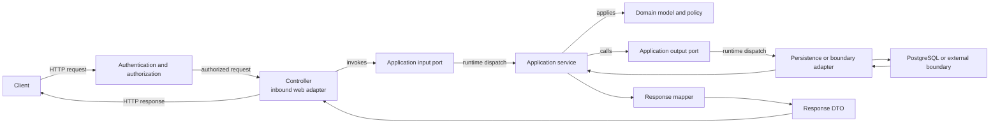

The application service owns the transaction and business decision. A controller must not call a repository, JPA entity, or persistence adapter directly. An adapter must not decide a LoanApplication or LoanAccount transition.

---

## 3. Authentication, Authorization, and Ownership

Spring Security authenticates the Bearer token before a protected controller invokes its input port.

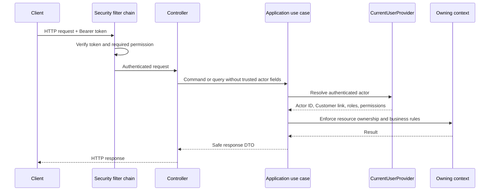

A permission authorizes an actor to attempt an operation. The owning context still verifies that the Customer, application, document, contract, or account belongs to that actor and is in a valid state.

Customer-owned endpoints derive `customerId` from `CurrentUserProvider`. They must not trust a Customer identifier supplied in the request when ownership is implied by the endpoint.

Staff-assisted endpoints resolve the authenticated Staff actor from `CurrentUserProvider` and may carry a selected `customerId` only when the contract explicitly represents a Staff operation on a Customer subject. The application service verifies Staff authority and Customer eligibility separately. It must not impersonate the Customer, create a synthetic Customer principal, or route the operation through Customer self-service input ports. A Staff-assisted Customer does not require an Identity User.

Audit evidence preserves the same distinction: the Staff user is the actor, while the selected Customer, intake, application, or other business record is the subject.

Access JWTs remain self-contained RS256 credentials, but embedded authority is accepted only while it is current:

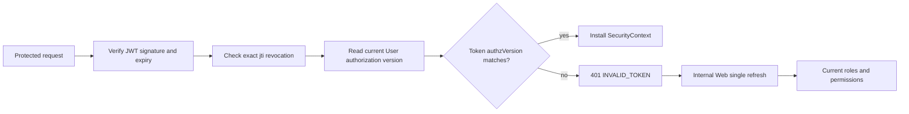

The version read is a purpose-limited User-ID lookup; authentication does not rehydrate password, role, permission, or other credential rows on every request. A mismatch is an invalid authentication credential, not a forbidden operation, and fails before embedded authorities enter the `SecurityContext`. An active User's established refresh session may rotate into a token with current authority. Suspension or disablement revokes all refresh sessions, so an inactive User cannot recover through refresh.

---

## 4. Read and Query Composition

Simple queries share one runtime pattern:

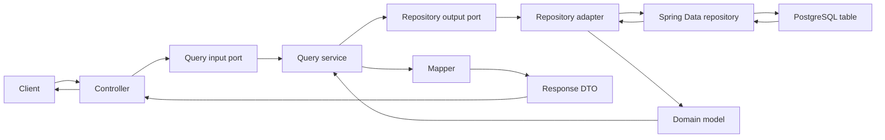

The query service pushes filtering and deterministic paging into persistence and validates a required parent before reading child collections. An absent required parent remains a missing-resource outcome rather than an empty collection. Public catalogue assembly selects active Loan Products; protected administration has a separate projection. Detailed Partner employment/salary evidence remains restricted to its authorized Staff purpose and must not be reused as a Customer DTO.

Specialized composition follows the same input-port/output-port boundary. Consistent case/history projections use their declared read transaction; an advisory read never replaces command-time locked validation.

### Advisory Readiness Query

The Salary Advance readiness query derives the Customer from the authenticated actor and reads Customer readiness, product policy, the Partner-owned current eligibility assessment, current limit/exposure, blocking applications, and outstanding-account guard, then returns safe values and blocker codes. Partner owns the current-month authoritative-batch decision; Loan consumes only the purpose-limited status and eligible snapshot.

The query is read-only and non-locking. Partner returns at most one explicit current `VERIFIED` relationship, and returns `NOT_VERIFIED` while any current-month Partner eligibility review remains pending. Loan does not inspect Partner review persistence. The query does not initialize or refresh a persisted limit, reserve exposure, create a LoanApplication or verification, or append movements, history, or audit. A later submission command reacquires authoritative state and may reject after concurrent change.

### LoanApplication Status Query

The shared status query returns a minimal durable Loan-owned projection and performs no mutation or next-action inference. The application service enforces Customer ownership concealment before mapping; Staff reads use their own authority. Structured Collateral, verification, actor, history, and servicing evidence remain separate purpose-limited queries defined in [MER-API-001](../api/MER-API-001-endpoints-and-postman-scenarios.md).

### Customer-own Collateral Facts Query

The Customer-owned Collateral read enters through its dedicated Loan input port and query service. The read-only application transaction requires a Customer-shaped actor with Customer context and exact `loan:read:own`, proves application ownership through `LoanApplicationRepository`, and reads the single submitted fact through `CollateralRepository`. An inconsistent row count or application relationship fails closed. The service maps only submitted immutable facts into `CustomerCollateralDto`; the HTTP fields and errors are defined in [MER-API-001 Section 4.2.1.1](../api/MER-API-001-endpoints-and-postman-scenarios.md#4211-customer-own-submitted-collateral-facts).

Loan owns structured Collateral facts. Document owns ownership evidence and checklist/version/review state, which the Customer reads through the separate Document input contract. This flow accesses neither another context's persistence nor Staff verification/assessment projections. It acquires no workflow lock and writes no state, history, or audit. Either origination channel permits this own-data read without granting a digital action or changing historical channel identity. The shared LoanApplication status query remains minimal.

### Staff Discovery and Case Queries

Staff application discovery and case reads use a dedicated Staff input port and query service. Controller and service authorization require an authenticated Staff actor with exact `loan:read`; Customer ownership reads remain separate.

The index applies product/status predicates, `submittedAt DESC, id DESC` ordering, and page bounds in persistence. The case read is side-effect-free and composes the application header, the existing purpose-limited Customer readiness snapshot, and transitions loaded in authoritative sequence order. It neither reaches Customer persistence directly nor copies audit events into Loan's HTTP model. Exact fields, exclusions, and error behavior are defined in `MER-API-001`.

### Staff Document Checklist and History Query

The Staff Document checklist/history read uses a dedicated Staff Document input port and query service. It requires a Staff-only principal and exact `document:review` or `approval:decide` independently of the general `loan:read` case contract. The latter audience inspects documents read-only and acquires no command or queue capability.

Document owns checklist, version, and review-history projection. It obtains only application existence and safe status through the purpose-limited Loan contract. Deterministic repository queries read the existing immutable version and review rows; no parallel history store is created. One batched `DocumentStaffActorDirectorySpi` lookup reaches Identity's inbound `DocumentStaffActorDirectoryAdapter`, which delegates to Identity's `QueryStaffActorSummariesUseCase` and maps its Staff-only summaries. Exact review-version associations are validated before returning separately labeled reasons, Customer instructions, and authorized restricted Document notes. Checklist and signed-form metadata use read-only repeatable-read snapshots.

### Correction and Signed-Form History Reads

Loan owns the specialized correction history projection. `LoanCorrectionRepository` returns every request in creation-time/identifier order and tasks in sequence/identifier order. A purpose-limited `WorkflowActorDirectoryPort` resolves creator, completer, and exactly matched resubmitter associations in one batch. Loan validates Customer ownership and permitted self-service versus Staff-recorded semantics; it never returns Customer login identity.

Resubmitter attribution requires a unique request timestamp and one same-application `RESUBMIT_CORRECTION` lifecycle transition at that exact timestamp, from `RETURNED_FOR_REVISION` to `SUBMITTED` or `UNDER_REVIEW`. Missing or ambiguous evidence yields an unavailable actor rather than inference. Stored task baseline links remain baselines because correction tasks do not retain an exact completion-proof version. The latest correction remains the action projection, and history does not change command locks, idempotency, maker-checker, audit, or transaction rules.

Document's `ReadStaffAssistedActionEvidenceUseCase` provides permitted signed-form metadata and exact immutable content. The service reads its existing assisted-action document/version repository and validates application, evidence type, logical-document ownership, and version before opening `DocumentStoragePort`. Historical viewing does not call upload target authorization, because completed or superseded action targets must remain inspectable. Loan-owned action state continues to identify the consumed version through its existing public contracts. No new aggregate, file copy, history table, or generic evidence engine is introduced. Exact per-type read audiences and HTTP error/header contracts are defined in MER-API-001 Section 5.7.

### Staff Product-Verification and Review Read Flow

Product-verification and review reads are Loan-owned purpose-limited projections. They authorize an exact Staff `loan:review` capability in the web adapter and application service, then assemble only the evidence needed to verify a product or start/reconcile Loan Officer review.

Loan does not read Document persistence or Customer persistence. Document resolves readiness and current immutable version targets behind `LoanDocumentChecklistPort`. The verification projection orders immutable product cycles by sequence and treats the latest as authoritative; Collateral additionally requires exactly one application-owned assessment snapshot. The review projection reads the latest Loan-owned review cycle and product result. Both reads are advisory presentation evidence: every mutation reacquires its established workflow/application locks and revalidates authoritative state.

Because verification start/completion and review start have no client business UUID, Internal Web never automatically retries their POSTs. After a lost response it performs the corresponding purpose-limited GET and reports only what the refreshed durable state proves. Collateral completion carries the displayed `expectedVerificationId`; a stale conflict preserves the in-memory form, refreshes the latest cycle, and requires an explicit new confirmation.

### Workflow Actor and Assisted Customer Action Reads

Loan composes Staff application lifecycle actors under the existing repeatable-read `loan:read` query. Its workflow-actor output port calls Identity's batched public classification contract through an Identity adapter; Loan never reads Identity persistence. The query requires matching `user_type = CUSTOMER` and application Customer association before returning `CUSTOMER_SELF_SERVICE`, with no Customer login fields. Staff summaries remain purpose-limited, System requires no User record, and missing legacy Users produce `UNAVAILABLE`.

Completed assisted offer-response and UCL cancellation reads compose existing Loan-owned action records, exact workflow transitions, Document-owned version metadata, and safe Staff recorder summaries. They validate subject/target, action/state, actor, time, operation correspondence, and consumed evidence version under the owning read transaction. Contradictions return `SYSTEM_STATE_CONFLICT`; the reads create no history, audit, or action records. Generic lifecycle history uses only validated high-level Customer decision/request wording. Detailed completed provenance stays in the offer-response and correction-case contracts. Accounting acknowledgment retains its existing contract-bound Customer/Staff distinction.

---

## 5. Origination and Customer Identity Evidence

### Origination Channel Boundary

Customer-digital and Staff-assisted origination use separate inbound contracts because they resolve actor and Customer subject differently. Customer-digital commands derive the Customer from authentication. Staff-assisted commands authenticate Staff and carry the selected Customer as an explicit business subject. Both paths converge only after those trust-boundary checks and then apply the same Customer readiness, product policy, workflow, audit, and concurrency rules for the selected product.

Salary Advance accepts only Customer-digital origination. UCL and Collateral Loan accept Customer-digital or Staff-assisted origination. A created `LoanApplication` records its immutable origination channel so later Customer-sourced corrections, offer responses, and contract acknowledgments use the permitted interaction path without changing financial, review, approval, or maker-checker authority.

A Customer self-service command must not be generalized by adding an optional Staff-selected `customerId`. Staff entry points use purpose-specific input ports and may share internal application or domain logic only after actor and subject resolution.

### Staff-Assisted Customer Intake

Staff Customer discovery and mutation belong to Customer-owned input ports rather than Loan or Identity persistence. Discovery returns a purpose-limited result suitable for selecting an existing Customer; it must not expose an unrestricted Customer directory or reuse Customer `/me` contracts.

Creating a new Staff-assisted Customer and its required identity-bearing profile is one Customer transaction. Customer protects the identity reference, rejects a duplicate protected identity before committing a separate Customer, persists the Customer and profile, and records the Staff actor with the created Customer as the business subject. A duplicate-identity failure rolls back the complete command. Bank-account changes use separate purpose-specific Customer commands and retain Customer's existing sensitive-data protection rules.

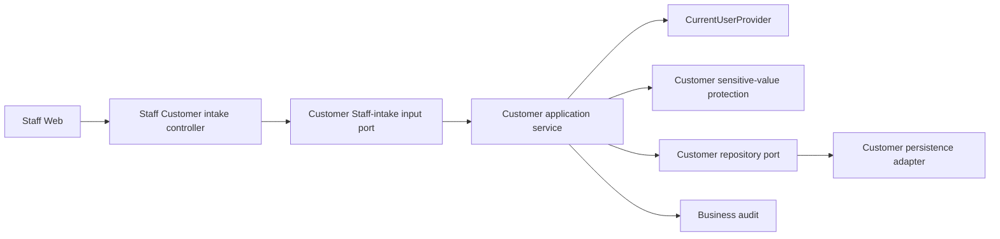

### Staff-Assisted Pre-Application Intake and Paper Evidence

Direct origination creates a `LoanApplication` in `SUBMITTED` or `DOCUMENTS_PENDING`; there is no persisted save-and-return application-draft command. Loan owns the separate temporary Staff-assisted intake lifecycle that exists before a UCL or Collateral Loan `LoanApplication`. The intake creates no financial exposure and does not enter product verification, review, or Approval. Loan may associate the intake with a selected Customer and product while Staff confirms Customer-provided structured facts.

Document owns paper intake evidence independently of application checklists. A Staff upload to pre-application intake uses a Document-owned input port. Document asks Loan through a purpose-limited boundary whether the intake is valid for the requested operation, then stores the immutable document version under Document ownership. Initial intake upload must not reuse correction-task authorization because no application correction exists yet.

Exact intake content reads use the same purpose-limited Document-to-Loan case authorization boundary. Document validates the case, product/evidence type, logical document, and immutable version association before opening Document-owned storage. Historical evidence remains readable without becoming a current mutation or OCR target, including after intake completion or abandonment. Retrieval does not mutate Loan or Document state or copy intake bytes into an application checklist. [MER-API-001 Section 3.19](../api/MER-API-001-endpoints-and-postman-scenarios.md#319-staff-assisted-customer-and-pre-application-intake) owns the exact audience, content response, and failure contracts.

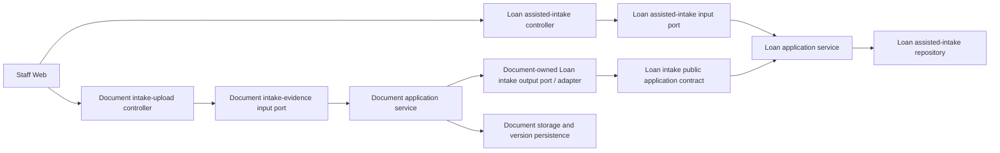

The intake-to-application command serializes the intake before application creation and permits one resulting `LoanApplication`. It revalidates the selected Customer, allowed product and channel, readiness, amount, term, blocking application, and product-specific outstanding-account rules rather than trusting values captured earlier in the intake. If application creation requires Document to associate intake evidence with the application workflow, Loan uses a Document public contract; it does not rewrite Document persistence. Failure of a required association rolls back the conversion business outcome.

### Submission Command

The Salary Advance command derives the Customer from authentication and obtains Customer and Partner facts through their public contracts. It uses Loan repository ports for the product, blocking applications/accounts, limit, movements, and immutable verification snapshot. Document resolves the initial checklist and creates it inside the origination transaction. Ordinary responses remain purpose-limited and exclude Partner salary, identity evidence, employee code, bank-account data, and raw matching evidence. The order below protects the complete outcome.

### Submission Serialization and Database Guard

The transaction follows this order:

1. obtain locked Customer readiness and validate product/amount/term policy before Loan workflow locks;
2. acquire the Customer-and-product advisory lock and perform the authoritative blocking-application check;
3. resolve Partner-owned current-month eligibility and calculate the effective limit;
4. acquire the Customer-and-employee-link advisory lock and repeat the blocking check;
5. inspect blocking LoanAccount evidence;
6. lock or initialize the Salary Advance limit;
7. reserve exposure and persist the application, verification snapshot, history, and audit atomically.

The partial unique constraint for one blocking application per Customer and product is the final database guard. Only a violation of that exact constraint maps to `BLOCKING_APPLICATION_EXISTS`; unrelated integrity failures remain system errors.

A matching `ACTIVE` or `OVERDUE` Salary Advance LoanAccount with positive contractual outstanding returns `OUTSTANDING_LOAN_ACCOUNT_EXISTS`. A zero-outstanding `SETTLED` account clears only this guard; the submission must still satisfy every other rule.

Submission does not lock an existing LoanAccount. When repayment and submission compete, the established advisory-lock order makes submission either observe the committed settlement or conservatively reject once and succeed after refresh.

### UCL and Collateral Submission Variants

Customer-digital UCL and Collateral submission derive the Customer from the authenticated Customer actor. Staff-assisted submission authenticates Staff, resolves the selected Customer from the confirmed intake, and records `STAFF_ASSISTED` as the application channel. The Staff path must not call a Customer-owned submission input port or represent Staff as the Customer.

After actor and subject resolution, both channels use the same Customer readiness checks, active product and policy validation, Customer-and-product advisory lock, blocking-application check, checklist creation, status history, and PII-safe audit boundary. Each transaction creates its application-owned pending manual-verification cycle atomically with the submitted product evidence. Staff-assisted audit records the Staff user as actor and carries the Customer and application identifiers as the affected business references.

UCL also evaluates the product-scoped outstanding-LoanAccount guard under the Customer-and-product lock. Document creates the income and employment checklist, while Loan creates the application-owned pending verification; neither path acquires a Partner or Salary Advance exposure lock.

Collateral validates and persists one structured asset with type, description, estimated value, ownership status, and condition facts, while Document creates the required ownership-evidence checklist item. It has no product-specific outstanding-LoanAccount guard and acquires no Partner or Salary Advance exposure lock.

No Staff-assisted Salary Advance submission variant exists.

### Customer Identity Verification and Origination Readiness

Customer own-evidence commands authenticate the Customer before storage access, derive ownership from the principal, lock the Customer, and validate the active complete profile. A Customer-owned evidence port calls Document's public contract to validate and store one immutable digital version in the same transaction. The verification attempt, aggregate summary, exact version reference, and required audit commit together. Document deletes a newly committed storage object after transaction rollback and includes identity versions in orphan-reference checks.

For assisted evidence, the dedicated review capability first locks the Loan-owned case and resolves its selected Customer through a narrow public contract. Customer then locks that Customer; Document locks the `CUSTOMER_IDENTITY` document and validates its exact current version. No identity bytes or arbitrary browser-provided Customer ownership move through Loan.

A decision acquires the request-identity lock, checks replay, locks the assisted case when applicable, then locks Customer and exact Document evidence in that order. Customer reloads the attempt under its aggregate lock and rejects stale full-name or version context. VERIFY compares the transient presented Identity Reference against the Customer-owned fingerprint using constant-time equality. The response and audit contain no presented value. Terminal decisions, summary, and audit are atomic.

Ordinary Customer and Staff profile maintenance locks Customer and applies the domain invariant before persistence or audit: a material full-name change while `VERIFIED` fails before persistence. An omitted saved full name retains the authoritative profile name. Rejection changes no profile, summary, readiness reference, or history and emits no verification-invalidated audit. Permitted contact and employment changes retain verification. The historical `CUSTOMER_IDENTITY_VERIFICATION_INVALIDATED` audit action remains compatible with stored history; ordinary profile maintenance does not emit it. The permitted identity-amendment boundary belongs to MER-BIZ-001 Section 5.9.1.

Controlled Identity Reference correction repairs a pre-verification mistake only. It uses the existing Customer self-service or Staff intake authority and locks the Customer aggregate before checking active/complete/non-verified state and protected duplicate ownership. The current profile change, `UNVERIFIED` summary, and safe audit are one transaction. It acquires no Partner or Loan persistence and does not change verification attempts or Document references. Correction therefore serializes with verification decisions and new origination through the same Customer row lock. A pending mismatch can be retried only against unchanged current evidence and full-name context. The command has no request UUID; clients clear sensitive input and reconcile unknown outcomes through a safe Customer read before another deliberate command.

New Salary Advance, UCL, and Collateral origination paths obtain locked Customer readiness before the established Customer/product serialization and product-specific guards. The Customer row lock serializes submission against profile maintenance and verification decisions. Readiness requires both `VERIFIED` and the latest successful attempt matching the current full name; an unsupported legacy summary cannot satisfy it. Loan persists only the successful verification UUID. Salary Advance retains its additional Partner eligibility, limit locking, and exposure reservation rules. Downstream workflows do not acquire this origination guard. Historical null provenance is preserved.

---

## 6. Product Verification, Review, Approval, and Correction

Approval owns the immutable recommendation or decision record. Loan owns the active review cycle, correction workflow, and LoanApplication transition.

Review start takes the workflow lock and application row lock, rechecks product evidence and Document readiness, and establishes the first assigned Loan Officer or preserves the proven prior-cycle assignment. A different officer or unresolved legacy assignment fails before a new cycle, transition, or audit is saved. Recommendation checks the assigned officer through Loan's narrow contract; Approver maker-checker remains a separate check. Intake, verification, document, and correction activity do not establish review stewardship.

Approval exposes separate purpose-limited Staff projections for recommendation recovery, independent-decision recovery, and Approver discovery. The query service requires exact `approval:recommend` or `approval:decide` authority and composes Approval-owned immutable evidence with a narrow Loan-owned case boundary. Loan supplies application state, review-cycle, product-verification, Document readiness, correction options, and exact `APPROVAL_PENDING` queue membership without transferring ownership to Approval. Repeatable-read isolation keeps the composed evidence coherent.

The projections expose a current-actor maker-checker relation instead of internal User identifiers. The Approver queue keeps membership, product filtering, paging, and ordering on the server. It does not fetch the general `loan:read` index and filter in the browser.

Every recommendation command carries the review-cycle identifier shown to the Loan Officer. Every decision command carries the recommendation and review-cycle identifiers shown to the Approver. Approval compares these expected-state identifiers with the latest applicable Approval evidence and active Loan-owned cycle before it records, audits, or publishes an outcome. A mismatch returns `STALE_REVIEW_RECOMMENDATION` or `STALE_REVIEW_CYCLE` without an Approval or Loan side effect. These identifiers are concurrency guards; the commands still have no client business UUID.

Recommendation and decision outcomes use synchronous transaction participation because a failure to apply the structured outcome must roll back the source Approval record and the resulting Loan, Document, Audit, and history changes.

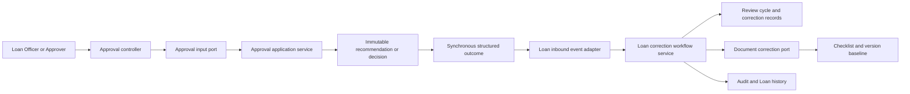

For `CUSTOMER_DIGITAL`, Customer-sourced correction endpoints derive the exact Customer owner from `CurrentUserProvider`. For `STAFF_ASSISTED`, a Customer-sourced correction uses a Staff-scoped input port: the application service authenticates Staff, verifies the application's channel and correction source, and records or accepts only information and evidence obtained from the Customer. The Staff user is the recording actor; the Customer remains the source and business subject.

A Customer-via-Staff correction remains distinct from a Staff correction of Staff-controlled work. Task completion, upload authorization, and resubmission must preserve that distinction rather than treating every Staff-executed command as `REQUEST_STAFF_CORRECTION`. Staff queue, content-read, review, waiver, and resubmission endpoints retain their narrow permissions, and application services recheck task ownership and maker-checker constraints.

The executable UCL/Collateral assisted path uses exact `loan:correction:staff` authority for purpose-specific Customer-task completion and Staff resubmission. Document authorizes replacement upload through the Loan-owned active-task boundary and exact `document:upload:assisted-correction`; the task baseline remains the concurrency proof. Loan records the authenticated Staff user as completion/audit actor and the application Customer as subject. Staff-task maker-checker remains unchanged but is not applied to a Customer-owned task merely because Staff records its Customer-provided proof. Customer-digital Customer tasks continue through the Customer-owned ports only. No generic Staff checklist-mutation port is introduced by these correction commands.

Staff-assisted UCL cancellation is a separate evidenced terminal command. Document authorizes `CUSTOMER_CANCELLATION_REQUEST` upload or exact-baseline replacement only for the active correction of a `STAFF_ASSISTED` UCL in `RETURNED_FOR_REVISION`. Loan requires exact `loan:cancel:staff` authority and the Loan Officer role, revalidates the same correction and current evidence version under the cancellation lock order, and then uses the common Loan-owned cancellation execution path. The authenticated Staff user remains the actor, the application Customer remains the subject, and the stored cancellation row references the consumed Document version by ID without a cross-context foreign key. Customer-digital cancellation remains on the Customer-owned port; Collateral and Salary Advance remain unsupported by this Staff command.

The Staff correction case query remains inside Loan because Loan owns the correction lifecycle:

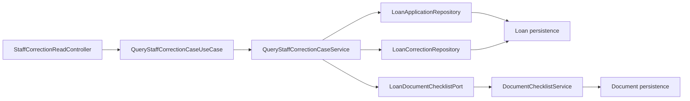

The service computes current-actor maker-checker evidence without serializing actor IDs. It derives Staff task proof through `LoanDocumentChecklistPort` and assisted-cancellation evidence through the narrow assisted-action evidence port; Loan does not query Document tables or adapters. The read is advisory presentation evidence, while completion, resubmission, evidence upload, and cancellation commands revalidate locked state.

### UCL Manual Verification

UCL verification start and completion acquire the LoanApplication workflow lock, the application row, and the authoritative latest UCL verification row. Completion rechecks Document processing readiness and atomically persists the verification result, LoanApplication transition, status history, PII-safe audit, and any structured `REQUIRES_MORE_INFORMATION` correction. `VERIFIED` opens Loan Officer review, `FAILED` ends the application as `VERIFICATION_FAILED`, and correctable evidence issues use `REQUIRES_MORE_INFORMATION` followed by a linked pending re-verification cycle after resubmission.

### Collateral Verification and Approval Coordination

Collateral manual-verification start and completion use the existing LoanApplication workflow serialization. Each command acquires the workflow lock, locks the application, and locks the authoritative latest `collateral_loan_verifications` row before it persists verification, status-history, correction, or audit effects. Start is a normal `SUBMITTED -> VERIFICATION_PENDING` transition: one concurrent request succeeds and later requests fail rather than replaying a successful response.

Completion carries `expectedVerificationId`. After locking the latest row, Loan rejects a mismatched identifier as stale before completing evidence. A successful command changes a pending cycle exactly once and atomically persists the terminal result, LoanApplication transition, history, audit, and any `REQUIRES_MORE_INFORMATION` correction. Document readiness is checked again inside the command. The database makes completed cycles immutable and reconciles each later cycle with the preceding completed cycle and its resubmitted source correction.

The latest `VERIFIED` cycle opens Loan Officer review and recommendation and must remain authoritative when an Approver acts. Approval writes the immutable decision before Loan handles the synchronous outcome in the same transaction. Loan rechecks the latest Collateral verification under the workflow/application lock. Missing or non-verified evidence, invalid or missing pricing policy, an invalid term, or a later mandatory write failure rolls back the ApprovalDecision together with every Loan transition, review-cycle, correction, audit, and ApprovedOffer effect.

`APPROVE` loads the active Collateral default policy and creates one exact-request immutable offer plus its reconciled provisional monthly items before reaching `CUSTOMER_ACCEPTANCE_PENDING`. The other three actions use the common reject, return, or document-only correction paths and create no offer. Competing decisions serialize to one authoritative outcome, and Collateral paths acquire no Salary Advance exposure locks or create Salary Advance movements. The channel-specific Customer-decision entry point then uses the common ApprovedOffer lock and terminal-action semantics; acceptance reaches `CONTRACT_PENDING` and opens the common operational-contract flow.

### Correction Locking and Idempotency

1. Document replacement locks the Loan workflow, then the checklist item and logical document. It appends a version only when the expected current-version identifier still matches.
2. Manual review targets one immutable document version and rejects a stale review target.
3. Ordinary Customer and Staff task completion locks the selected task, reads and validates its correction request, and locks the request's task set when required to reconcile readiness. It does not establish a correction-request row lock as a universal first lock. The assisted Customer-task command instead locks workflow/application, active correction request, then task. Each path preserves its actor, active-request, proof, and maker-checker checks. An identical completion is replay only after that path's guards; different content after completion is a conflict.
4. Resubmission locks the Loan workflow and application first, then the active correction request and task rows. It validates Customer readiness and product policy, acquires Customer-and-product scope, checks blocking applications, and reads Document readiness. Salary Advance then locks its product exposure state; UCL and Collateral do not acquire Salary Advance limit or movement locks.
5. Salary Advance resubmission rechecks Partner-owned current-month freshness; stale evidence rejects the operation before a new verification or workflow effect and preserves the existing reservation.
6. One resubmission request is consumed exactly once.
7. Collateral resubmission preserves the completed cycle and structured facts, returns the application to `SUBMITTED`, and creates one next pending cycle linked to the resubmitted correction. Concurrent resubmission permits one transition/cycle; a delayed completion carrying the prior cycle ID fails stale.
8. Customer-requested cancellation is defined only for Salary Advance and UCL returned corrections. Customer-digital requests derive the Customer owner from authentication. For Staff-assisted UCL, authorized Staff may record the Customer's evidenced cancellation request after verifying the application's channel and subject. The command first serializes the request UUID, then locks the Loan workflow, application, and active correction request. Salary Advance additionally locks Customer-and-product scope, latest verification context, Customer-link scope, reservation movements, and the Salary Advance limit before recording its exact release. UCL proves that no Salary reservation or release evidence exists and records no exposure effect. Both products terminalize the correction and application and record history, audit, and immutable cancellation evidence.
9. Cancellation intentionally does not recheck Partner freshness: Customer abandonment must remain possible after Partner evidence becomes stale. Resubmission and cancellation share the workflow/application/correction lock order, so a PostgreSQL race permits exactly one operation to win.
10. Failure in synchronous Approval-to-Loan coordination or any cancellation evidence write rolls back the entire transaction.

---

## 7. Offer, Contract, Protected Reveal, and Disbursement

### Channel-Specific Customer Decisions

After approval, Loan routes Customer-sourced actions by the persisted origination channel. `CUSTOMER_DIGITAL` uses Customer-owned input ports that derive the Customer from authentication. `STAFF_ASSISTED` uses purpose-specific Staff input ports that authenticate Staff, verify the selected application's Customer and channel, and record the evidenced Customer decision without impersonation.

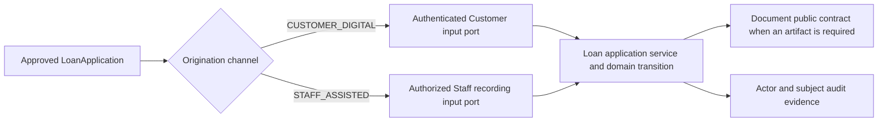

Offer acceptance or decline remains the Customer's decision. A Staff-assisted command records that decision only when supported by the required branch evidence; it must not let Staff choose on the Customer's behalf. Contract acknowledgment follows the same actor-versus-subject rule. Customer-requested cancellation follows the rule for the exact active correction of a Staff-assisted UCL and consumes the current signed cancellation-request evidence before the terminal transition. Customer-digital and Staff-assisted entry points may share the same Loan-owned offer, contract, or cancellation transition logic after their channel-specific authorization and evidence checks.

### Contract Preparation and Readiness

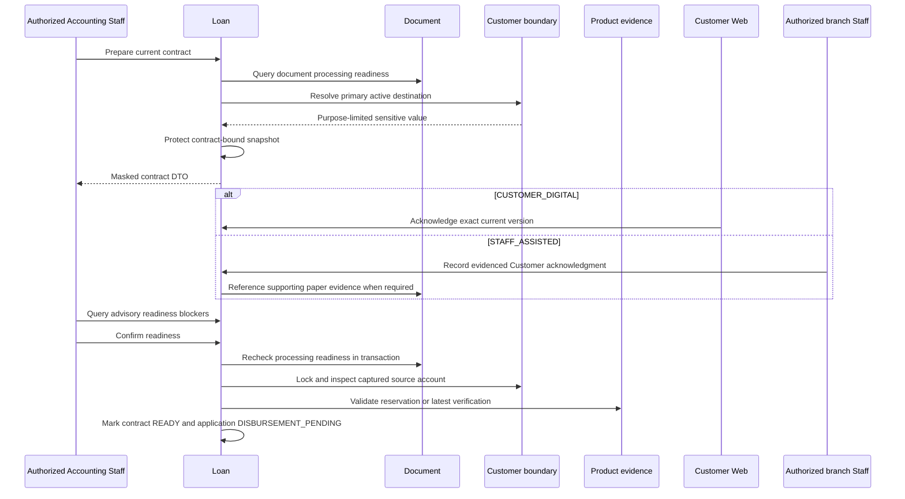

The advisory readiness query uses non-locking reads and does not persist a readiness Boolean. Confirmation acquires the workflow locks and recomputes every blocker before changing state.

Acknowledgment verifies the exact current contract version and required channel-specific evidence. The channel boundary above preserves the Customer source and Staff recorder separately.

Loan also owns the purpose-limited Staff contract-work projection. Its queue selects only `CONTRACT_PENDING` applications with server-side product filtering, paging, and deterministic ordering. Its case read admits only `CONTRACT_PENDING` and `DISBURSEMENT_PENDING`. Under one repeatable-read application transaction, the projection composes the application header, current Loan-owned contract, and the canonical readiness service result, then derives a work stage. Identity or lifecycle contradictions fail closed instead of being repaired in the controller or browser. The projection requires Staff `loan:contract:read` authority and Accounting Officer role; it does not transfer Customer acknowledgment ownership or expose the protected destination.

For Accounting contract and disbursement cases, Loan also composes a purpose-limited handoff read. A Loan-owned output port obtains Customer number and full name through a narrow Customer application contract. Another obtains the exact `APPROVE` decision actor and time from Approval, correlated to the `ApprovedOffer` referenced by the current contract. Loan reads prepared, acknowledged, and readiness actors from that contract, assisted acknowledgment evidence from its exact contract version, and the completed disbursement actor from `ManualDisbursement`. The existing Staff actor directory resolves required display identities through Identity in a batch. Missing or contradictory required evidence fails closed. Loan does not read Customer, Approval, or Identity persistence directly, and the composition creates no new workflow or business record.

Loan stores a protected contract-bound destination snapshot. Normal contract responses expose only the masked destination. Full destination data is available only through the dedicated audited reveal flow.

Salary Advance validates its exact unreleased reservation. UCL and Collateral Loan require the authoritative latest application-owned verification to be `VERIFIED`; contract preparation performs this product-evidence validation before reading or protecting bank-account data. Collateral contract versions copy the accepted offer's financial terms and provisional items exactly; pricing policy is defined in BIZ, not recomputed here. Destination refresh supersedes the prior version without repricing and requires a fresh Customer acknowledgment through the application's origination channel. UCL and Collateral paths do not acquire Salary Advance exposure locks or create Salary Advance movements.

### Application-Scoped Customer Identity Reference Reveal

```text
StaffCustomerIdentityReferenceController
  -> RevealStaffCustomerIdentityReferenceUseCase / Loan application service
  -> LoanApplicationRepository -> exact LoanApplication.customerId
  -> CustomerIdentityReferenceRevealPort -> boundary adapter
  -> RevealCustomerIdentityReferenceUseCase / Customer application service
  -> CustomerRepository + CustomerSensitiveValueProtector.revealToBytes
  -> synchronous transactional business audit
  -> transient result / redacted DTO / private no-store response
```

Controller permissions and application-layer actor checks establish the dedicated Loan Officer purpose. Loan resolves the subject from the authoritative application and never accesses Customer persistence or protected envelopes. Customer validates a complete identity-bearing profile, strictly decodes and validates the decrypted value against its stored last-four facts, and clears the decrypted byte array in `finally`. The returned String is transient and cannot be reliably zeroed; it must never be persisted, logged, or cached.

Loan and Customer application services share the reveal transaction. Customer publishes the safe successful-access audit synchronously; persistence failure prevents a successful response. This read-purpose command changes no lending state, verification state, or lifecycle history and imposes no review-assignment or identity-verification-status guard. Ordinary case projection never invokes decryption. Exact authorization, payload, headers, and errors belong to MER-API-001 Section 4.2.2.1.

### Disbursement-Destination Reveal and Confirmation

Loan owns the Staff disbursement queue and case projection:

```text
StaffDisbursementWorkController
    -> QueryStaffDisbursementWorkUseCase
    -> QueryStaffDisbursementWorkService
    -> Loan-owned repositories
    -> safe StaffDisbursementWorkPageDto or StaffDisbursementCaseDto
```

The queue selects only `DISBURSEMENT_PENDING` applications with server-side product filtering, paging, and deterministic ordering. Loan verifies the current confirmed, non-superseded `READY_FOR_DISBURSEMENT` contract, matching destination identity, and absence of contradictory activation evidence before returning `READY_TO_DISBURSE`.

The case projection composes one pending or completed case under a repeatable-read transaction. A `DISBURSED` result requires coherent Loan-owned `ManualDisbursement`, LoanAccount, and final `RepaymentSchedule` evidence linked to the same application, contract, version, and activation outcome. Any lifecycle, identity, version, financial, date, or timestamp contradiction fails closed with `SYSTEM_STATE_CONFLICT`. The controller and browser do not repair or infer missing state, and the query does not access another context's persistence.

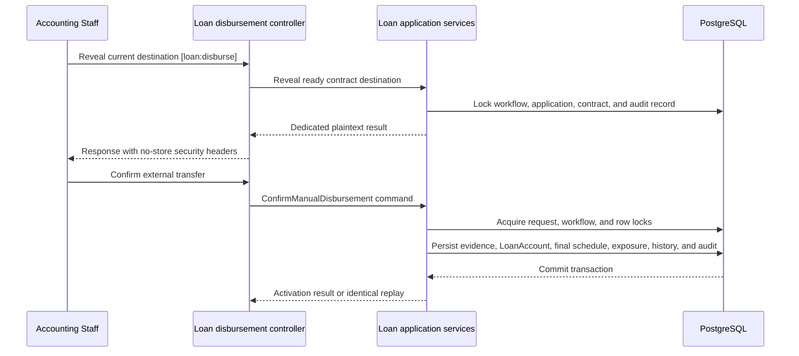

The reveal endpoint is separate from ordinary reads and requires `loan:disburse`. Its response must use private, no-store, and content-sniffing protection and must not be retained in general DTOs or logs.

The disbursement command carries caller-supplied request identity and external transfer evidence. It does not accept authoritative actor, Customer, contract, product, destination, or contractual financial terms from the request. Loan resolves those facts from protected state.

Request and workflow advisory locks use separate categories. Identical request replay returns the original outcome without new writes. Reusing the request identity with different content returns an idempotency conflict.

The product activation policy revalidates the authoritative product evidence for both first execution and completed replay. Collateral activation requires the latest verification to remain `VERIFIED`, creates the common active LoanAccount and exact final dated monthly schedule, and reports zero product exposure without touching Salary Advance state.

---

## 8. Servicing, Repayment, Settlement, and Closure

LoanAccount is the authoritative servicing aggregate. Queries compose account/schedule/progress or immutable operation evidence; repayment, Administrative Full-Balance Settlement, and administrative closure remain separate commands. [MER-API-001](../api/MER-API-001-endpoints-and-postman-scenarios.md) owns endpoint audiences and fields; [MER-BIZ-001](../business/MER-BIZ-001-business-requirements-and-workflows.md) owns lifecycle policy.

Customer ownership concealment belongs in the application service. A Customer receives the same not-found behavior for a missing, foreign-owned, or not-yet-activated account.

Staff servicing discovery follows:

```text
StaffServicingWorkController
  → QueryStaffServicingWorkUseCase
  → QueryStaffServicingWorkService
  → StaffLoanAccountWorkQuery
  → Loan-owned persistence query
  → PII-minimized page DTO
```

LoanAccount status owns queue membership. The purpose-limited persistence query filters and pages `ACTIVE` and `OVERDUE` accounts before projection and joins LoanApplication only for application identity and product facts. The read validates positive outstanding, `DISBURSED` application state, and coherent account/application evidence under a repeatable-read transaction. It does not access Customer persistence, calculate overdue state, or create a browser-owned queue. Ordinary repayment continues through the existing `RecordRepaymentService`; the discovery read neither invokes nor duplicates that command flow.

Settlement and closure discovery use separate Loan-owned projections. Settlement work contains only coherent `DISBURSED` applications whose LoanAccounts are `ACTIVE` or `OVERDUE` with positive outstanding and authoritative final-schedule progress. Closure work contains only `SETTLED` accounts with zero outstanding, fully paid final progress, a coherent terminal repayment outcome, contractual-payoff or approved-settlement history, reconciled product-release evidence, and no existing closure. Both reads page before presentation, order by activation time and LoanAccount identifier, expose only operational facts, and return `SYSTEM_STATE_CONFLICT` instead of presenting a contradictory candidate.

The approved-settlement recovery read is application-scoped and Approver-only. It verifies immutable settlement, payment, and terminal account evidence and excludes the request UUID, external payment reference, actor identity, audit identity, and internal settlement identity. This read reconstructs only non-sensitive semantic fields; an exact replay remains the authority for an unresolved request result.

Loan owns the Staff servicing-provenance projection. A repeatable-read query checks the exact ManualDisbursement and activation transition, ordered LoanAccount status chain, repayment transactions, ApprovedLoanSettlement and its payment/transition, and LoanAccountClosure and its transition. Financial repayment rows and their recording actors are bound by transaction ID in one backend snapshot; a repayment need not change account status. Loan resolves all USER actor IDs through its Staff actor directory port in one Identity batch. SYSTEM transition events retain a null Staff summary and require no Identity lookup. Missing or contradictory required evidence returns `SYSTEM_STATE_CONFLICT`. Customer-readable LoanAccount and repayment contracts exclude Staff identities. Business audit persistence is not a servicing read source.

Activated Collateral LoanAccounts participate in the common safe read and the common repayment, overdue evaluation, contractual-payoff, Administrative Full-Balance Settlement, and administrative-closure services. The Collateral repayment policy validates product identity and requires zero product-exposure release; it has no Partner, Salary Advance limit, or post-activation verification dependency.

Read operations must not:

- lock workflow rows;
- evaluate overdue state;
- recompute financial outcomes;
- publish business evidence;
- expose transfer references, full destinations, encryption envelopes, audit identifiers, employee evidence, or limit-movement internals.

Repayment locks request identity, checks for conflicting reuse, acquires the application workflow lock, and repeats replay lookup before locking application, account, final schedule, and progress. The domain allocator applies payment in deterministic installment/component order against immutable obligations. Payment, allocations, progress, account roll-up, installment/account history when state changes, product release, durable operation outcome, and audit commit atomically. Overpayment is rejected before those writes. Replay validates the original operation and product-release evidence and returns the stored outcome even after later servicing changes; it does not recalculate the result from current balances.

The repayment and Administrative Full-Balance Settlement controllers forward external payment references without canonicalizing them. The Loan application services own normalization, operation-specific idempotency, and duplicate-reference handling. The canonical external payment reference remains internal financial evidence and is excluded from ordinary responses, logs, audit payloads, and errors.

Administrative Full-Balance Settlement is a Loan-owned payment operation even though its actor is an Approver. It starts from `ACTIVE` or `OVERDUE`, requires the caller's expected amount to equal locked total outstanding, applies the repayment allocator and servicing calculator, and commits `SETTLED` with immutable settlement, payment, outcome, history, and audit evidence. The selected repayment policy releases allocated principal exactly for Salary Advance and requires zero product-exposure release for UCL and Collateral Loan.

Administrative closure starts only from a fully reconciled `SETTLED` account. It accepts contractual-payoff provenance or Administrative Full-Balance Settlement provenance, verifies final progress, product-specific exposure semantics, status history, and durable evidence, then records `SETTLED -> CLOSED`. It does not acquire Salary Advance limit locks because it performs no financial or exposure mutation.

### Mutation Lock Order

Existing application and account mutations use this global order:

1. operation-specific request advisory lock;
2. LoanApplication workflow advisory lock;
3. LoanApplication, LoanAccount, final-schedule, and servicing-progress row locks in operation-specific order;
4. product-specific exposure locks when required;
5. Salary Advance Customer-and-employee-link, limit, and movement rows when the selected policy mutates Salary Advance exposure.

Activation, repayment, and Administrative Full-Balance Settlement must not acquire product-specific exposure locks before the LoanApplication workflow lock. Salary Advance Administrative Full-Balance Settlement follows request lock, workflow lock, application/account/schedule/progress row locks, payment validation, Customer-and-employee-link lock, then limit and movement locks. UCL and Collateral Loan use the same common financial locks but acquire no Salary Advance exposure lock or row. Canonical external payment-reference uniqueness is enforced by the payment insert and its database constraint; a conflict is resolved without exposing the reference. Administrative closure stops after workflow, application/account, and settlement-evidence verification because it does not mutate exposure. Submission and standalone limit refresh retain their Customer/product or Customer/employee-link to limit order and do not acquire an existing application workflow or account lock.

### Overdue Evaluation

The overdue batch samples the injected clock once and derives one UTC business date. It selects stale `ACTIVE` or `OVERDUE` accounts with positive outstanding balances for the authoritative Salary Advance, UCL, and Collateral product allow-list, in deterministic evaluation-date and LoanAccount-ID order.

Each candidate runs in its own transaction and follows:

```text
LoanApplication workflow lock
  → LoanAccount lock
  → final schedule and servicing-progress locks
  → overdue calculation
  → persisted installment and account status changes
```

A previous evaluation date is a state conflict. Repeating the same date is a no-op. A later date advances only the persisted evaluation and derived status. An open account with zero outstanding balance is a system-state conflict.

The direct evaluator validates the application is `DISBURSED` and then resolves the product repayment policy before loading and mutating servicing state. Collateral evaluation follows the same persisted date/status calculation as UCL and creates no Salary Advance exposure evidence.

One overdue-evaluation operation identifier groups installment changes produced by the same evaluation. A real `ACTIVE` to `OVERDUE` or `OVERDUE` to `ACTIVE` account transition records account history and one `LOAN_ACCOUNT_STATUS_CHANGED` audit event. Date-only or installment-only advancement does not create a top-level account-status audit.

The scheduler uses an explicit UTC zone, a positive batch size, and explicit operational enablement.

---

## 9. Partner Snapshot, Import, and Eligibility Coordination

### Company Administration and Complete-Snapshot Import

Partner Company create, update, and status commands require exact `partner:manage`. Partner serializes update and status mutations through a locked company read. Company code remains stable after creation, database uniqueness is the final create boundary, and a same-status request produces no duplicate save or audit effect.

The effective-month import command uses this transaction order:

1. acquire the operation-scoped advisory lock for `requestId`;
2. return the stored outcome for an exact semantic fingerprint, or reject conflicting reuse;
3. lock the Partner Company and verify that it exists without treating inactive or suspended status as an import prohibition;
4. validate every row in the complete effective-month roster, including duplicate employee codes;
5. if any row is invalid, persist a `FAILED` batch with validation counts and safe rejection summary, publish `PARTNER_EMPLOYEE_IMPORT_FAILED`, and commit without employee writes or reconciliation; otherwise persist one `COMPLETED` batch and the entire roster;
6. if the new batch is the deterministic latest `COMPLETED` batch for that Partner Company and current UTC month, load the company's existing `VERIFIED` links in deterministic Customer/link order;
7. lock and re-read each candidate link, continue only when it remains the Customer's `VERIFIED` relationship for that Partner Company, and skip it when the Customer and Partner Company have a pending eligibility review;
8. compare the remaining link's stored verified identity reference and employee code with employees in the new batch through the normal Partner matching policy;
9. refresh the same link to the new employee and source batch only for `MATCHED_ACTIVE`, leaving missing, ambiguous, inactive, or displaced matches unchanged and therefore stale or historical;
10. publish one PII-safe business audit outcome before committing the complete import result.

The Partner Company row remains the import reconciliation serialization boundary. The import path does not acquire the Customer-wide or Customer–Partner advisory lock after that row lock and does not mutate pending review rows; verification and review decisions acquire Customer-wide, then Customer–Partner, then company locks. A failure after a link refresh rolls back the batch, employees, link changes, rejection summary, and audit outcome in the same transaction.

Request replay evidence stores the UUID and a SHA-256 semantic fingerprint rather than the raw command. Exact replay returns before reconciliation, so it does not advance link refresh timestamps or repeat audit effects. Multiple batches for the same company and month remain historical evidence. Each completed batch is a complete snapshot, and deterministic latest-completed selection replaces the previous snapshot without merging rows. A failed command cannot displace that authority. Valid/invalid counts describe validated rows; a failed batch contains no employee records. Exact replay also preserves a failed result; corrected input needs a new request ID. Only the deterministic latest completed current-month batch may refresh links. Partner mutates only the Partner-owned relationship. It does not create or change LoanApplications, Salary Advance limits, movements, or exposure. Loan readiness projects the current effective limit from Partner eligibility, and Loan persists its own limit refresh during submission when required.

### Employee Verification

The flow derives `customerId` from the authenticated Customer. The request supplies matching input such as `employeeCode`; it does not supply the trusted Customer identity. Partner obtains the required identity reference through a narrow Customer contract only for an active Customer with a complete profile and verified identity. An unverified or rejected identity returns `CUSTOMER_IDENTITY_VERIFICATION_REQUIRED` before employment matching. Manual review approval applies the same prerequisite. Current eligibility reads compare that identity with the link's preserved `verifiedIdentityRef`; mismatches return `NOT_VERIFIED` and cannot authorize Salary Advance.

Runtime rules:

1. Partner Company existence and active status are checked before import-batch lookup, employee matching, link creation, or manual-review routing. Partner derives the current effective month from the shared UTC `Clock` and selects the latest valid `COMPLETED` batch for that Partner Company and exact month, ordered deterministically by creation time and identifier.
2. Verification acquires the Customer-wide Partner-employment advisory lock before the narrower Customer–Partner Company lock. One active match creates the first relationship, refreshes the same current relationship when its evidence matches, or disables the current relationship and creates a fresh link when the proven employer differs.
3. Different same-employer evidence and missing or ambiguous current-month evidence follow the authorized manual-review policy. A genuinely unresolved current-month pending review makes the current eligibility contract return `NOT_VERIFIED`, even when an older current link remains persisted. Exact `MATCHED_ACTIVE` verification and successful manual approval supersede all remaining pending reviews for that Customer and month in the same transaction. The Customer-wide employment lock serializes these writes across Partner Companies; no additional company or advisory lock is acquired for competing review rows. Import reconciliation does not perform supersession. `MATCHED_INACTIVE` resolves only the selected company's pending attempt. Unresolved and rejected attempts leave alternative reviews pending. `SUPERSEDED` reviews are excluded from Customer discovery and pending eligibility checks. A reused verified link whose source batch or employee batch is not authoritative fails closed as stale for lending eligibility.
4. An inactive Partner Company or Partner Employee is a hard stop. Re-verification may restore eligibility only by refreshing the link to matching active evidence in the authoritative batch.
5. The response may expose identifiers, outcome, link status, and whether manual review is required. It must not expose raw identity evidence, employee code, salary, Salary Advance limit, or matching evidence.

A review bound to a replaced source batch returns `SOURCE_BATCH_REPLACED` with unavailable decisions. Its source evidence remains unchanged. Fresh Customer verification uses the authoritative batch and either establishes current employment or supersedes the obsolete same-company pending review before creating the correct current review. Page refresh does not retarget historical reviews.

### Eligibility Manual Review

Customer verification and Back-Office decisions acquire the Customer-wide Partner-employment advisory lock before the Customer–Partner Company boundary. This order serializes automatic and reviewed switches across different Partner Companies. Missing or ambiguous evidence creates or reuses one Partner-owned `PENDING` review. A changed source batch supersedes the obsolete pending review when fresh Customer verification creates a replacement; a successful automatic match supersedes it without requiring a hidden mutation from a read request.

Queue and detail reads require exact `partner:read`; the decision command requires exact `partner:manage`. The queue has no persisted assignment, claim, or reassignment state. Detail responses expose employee code and active employment facts needed for this restricted purpose, but exclude Customer identity references, salary, Salary Advance limit, and unrestricted notes.

The decision transaction follows this order:

1. locate the review, acquire the Customer-wide Partner-employment boundary followed by the Customer–Partner boundary, and lock the review row;
2. return an exact persisted terminal replay or reject a different decision after resolution;
3. lock and revalidate the Partner Company, effective UTC month, and authoritative latest `COMPLETED` import batch;
4. for approval, obtain current usable Customer identity evidence and validate the selected active Partner Employee against the authoritative batch and identity;
5. update the current same-employer link, or flush its transition to historical `DISABLED` before inserting a fresh different-employer `VERIFIED` link; rejection records `MANUAL_REVIEW_REJECTED` without a link mutation;
6. persist the controlled reason, reviewer, decision time, selected employee/source evidence when approved, and PII-safe audit outcome in the same transaction.

A prior-month review or a review bound to a replaced authoritative batch returns a stable stale-review conflict and requires fresh Customer verification. Import-time reconciliation never resolves or mutates a pending review. It keeps the Partner Company row as its first business lock, locks and re-reads each candidate link, and refreshes only a row that remains `VERIFIED` for that company. It does not acquire the Customer-wide advisory lock after the company lock, so an import cannot invert the verification lock order or restore a displaced historical relationship.

---

## 10. Identity Security Flows and Post-Commit Notification

### Registration, Verification, and Password Recovery

Identity separates transactional credential state from external delivery. Customer registration synchronously calls Customer through an output port and boundary adapter; Customer creation, Identity User/role association, and the digest-only verification token commit together. Only after the transactional service returns does the orchestrator call Notification. A registration or token-write failure therefore produces no email; a transport failure leaves the committed account and token available for the supported recovery flow.

Email-verification resend and password-reset issuance lock the User, revoke an older unused token, and store a replacement digest in their own Identity transaction. Confirmation locks the exact digest-addressed token and User. Email confirmation returns successfully for a consumed token only when the User is already verified; otherwise it rejects revoked or expired authority before marking verified and consuming the token. Password reset instead requires an active, email-verified User and an unconsumed, unrevoked, unexpired token, then atomically replaces the password, consumes the token, clears login protection, and revokes refresh sessions. Raw secrets remain transient; neither database audit nor durable `event_publication` contains a token-bearing message.

The four delivery purposes are Customer verification, password reset, Staff setup, and existing-Customer digital-access invitation. Identity-owned output ports call Notification's purpose-specific input contracts through infrastructure adapters. Notification renders a controlled template and invokes its email-sender port; SMTP remains an output adapter. It does not own token validity or credential outcomes. Delivery failure cannot roll back committed Identity/Customer state and does not imply a durable delivery/retry platform.

### Internal User Administration and Staff Setup

Protected Staff User and predefined-role discovery plus status and role-assignment commands use `/api/v1/admin/internal-users` and require exact `identity:user:manage`. Identity returns a purpose-limited Staff projection and excludes Customer Users and credential internals.

Staff provisioning uses the same protected boundary. Identity validates an unused normalized email and predefined non-Customer roles, then persists a Staff User without a Customer association, its role assignments, a digest-only password-reset token, and actor-bound PII-safe creation and role-grant audit evidence in one transaction. The placeholder password is an unguessable hash. Administrative provisioning marks the Staff email verified in Identity; Customer email verification remains separate. After commit, Identity calls a purpose-limited Notification contract that sends the setup fragment link to Internal Web. An explicit Staff-only resend locks the User, replaces an older unused token, and sends after commit. Delivery failure does not reverse durable Identity state; the administrator can request another link. The existing password-reset confirmation consumes the token, replaces the password, and revokes refresh sessions.

Every status and role command locks the target User before validating that it is internal Staff and before touching `role_assignments`. A same-target request returns the current projection without persistence, timestamp, version, session, or audit effects. A real change updates `users.updated_at` and increments `authorization_version` once. Role changes retain refresh sessions for an active User; a status change to `SUSPENDED` or `DISABLED` revokes all target-User refresh sessions in the same transaction. Reactivation increments the version but never restores a revoked token family. The audit entry records the authenticated actor, `IDENTITY_USER` target ID, controlled action, and status or role code without email or credential data.

### Existing Customer Digital Access

The protected Staff Customer-intake activation and status routes require exact `customer:intake:manage` and an authenticated Staff User without a Customer association. Identity owns the User link and credential state. Its consumer-owned Customer verification port calls a Customer public application contract; Customer locks the selected aggregate, requires `ACTIVE` and an identity-bearing profile, and matches the presented identity fingerprint without exposing stored raw evidence. An incomplete business profile does not block this identity proof. The submitted reference remains transient and never enters an audit or response.

Identity creates one `CUSTOMER` User for the unchanged `customerId`, a `CUSTOMER` role assignment, an unguessable hashed placeholder secret, independent digest-only email-verification and password-setup tokens, and one actor-bound `IDENTITY_CUSTOMER_DIGITAL_ACCESS_ENABLED` audit outcome in one transaction. The Customer lock serializes competing activation attempts for that Customer, while unique normalized-email and Customer mapping constraints remain final database authorities. An insert conflict is classified without querying inside an aborted transaction. No Customer or Loan aggregate is written.

After the creation transaction commits, Identity calls its Notification output port to deliver one purpose-specific Customer Web activation fragment link carrying both opaque secrets. Both tokens expire together under the email-verification lifetime; the setup token uses existing password-reset persistence. Delivery failure leaves the linked User and both tokens durable. Email confirmation precedes first-password setup through the existing password-reset confirmation, which requires verified email and owns password hashing, consumption, login-protection reset, and refresh-session revocation. No second credential mutation path or onboarding status is introduced; Staff never chooses or learns the Customer password. The Staff client reconciles an unknown command result with the protected digital-access read and does not automatically repeat the creation command. Customer-owned Loan reads use the original `customerId`; historical `STAFF_ASSISTED` applications retain their channel and have no manufactured digital action.

---

## 11. OCR Processing and Review

Document creates an explicit job for an exact current intake version after Loan's open-case authorization. Queue processing is asynchronous; Staff review finalization is a separate Document transaction. Applying finalized suggestions populates Staff form inputs, and the existing Customer or Loan command remains the authoritative business mutation.

[MER-ARCH-005](MER-ARCH-005-ocr-architecture.md) owns the queue lease/recovery model, case → document → result review lock order, current-version/expected-result guards, encrypted result/review handling, and manual fallback. [MER-DB-001](../database/MER-DB-001-data-model-and-erd.md#67-document) owns the logical job/result/review relationships. Worker disablement is a deployment choice and does not change these ownership or advisory boundaries.

---

## 12. Replay, Concurrency, and Failure Boundaries

### Transaction and Event Participation

Application services own transaction boundaries. Synchronous provider application calls participate in the coordinated outcome where partial persistence would be invalid. Approval publishes structured outcomes through plain synchronous `@EventListener` adapters into Loan input ports; this applies to recommendation and decision outcomes, including offer generation and correction continuation. These are not after-commit notifications. A required Loan, Document, history, or audit failure rolls back the source Approval record and every participating write.

Business audit uses a synchronous listener and a recording service with mandatory transaction propagation. Required PII-safe audit entries and operation correlation commit with the originating transition. A failed audit write prevents success; audit is not the read projection or replacement source for workflow provenance. There is no independently committed audit success that can legitimize a rolled-back financial result.

External file storage is not a database participant. Document stages uploads, validates replay under the operation's ownership and baseline locks, and promotes new content only after a clean mandatory malware scan. Unsafe content and scanner unavailability fail closed. Exact stored upload replay returns before promotion/scanning. Rollback cleanup removes newly promoted objects; staged content is discarded, and orphan checks protect references across Document's evidence families. Upload size/media/HTTP contracts belong in API-001.

Durable asynchronous event publication and configured startup republication are infrastructure recovery mechanisms. They do not change the synchronous Approval/audit boundaries above or guarantee delivery/retry for secret-bearing Notification commands. Any decoupled consumer must define its own idempotency and recovery semantics.

### Request Identity and Unknown Results

Request UUIDs are operation-specific business identities, not a universal HTTP idempotency layer. Where a command defines replay, it validates the same actor, subject, evidence/baseline, and logical content according to that command before returning the stored outcome. Conflicting identity reuse fails without a second effect. Some commands revalidate current case/version or product evidence before replay; exact replay is not permission to bypass those guards.

A lost response is an unknown result. Preserve the original request identity and logical content when exact replay is supported. An ordinary query can reconcile durable state but does not prove that a particular unresolved request succeeded. Commands without a business UUID, including verification/review starts and Approval actions, require a purpose-limited re-read and deliberate new confirmation rather than automatic command repetition. Idempotent field/target operations and non-UUID terminal replays retain their own documented semantics.

### Concurrency and Financial Failure Boundaries

Use the operation-specific lock sequences in the preceding sections. Existing-application financial commands acquire request serialization before workflow and aggregate locks; origination and standalone limit refresh have different Customer/product or Customer/link ordering. No generic lock template overrides those exceptions. Database uniqueness, immutable history, and deferred reconciliation are final integrity guards; commit-time failure must roll back the complete business outcome, including financial movements, history, and audit.

Time-sensitive commands use the injected UTC clock. Where one operation needs a common instant/date, derive them from one sample; normalize immutable servicing timestamps consistently across relational and JSON evidence. Reads must not repair contradictory records or infer missing actors, financial evidence, or consumed versions.

### Loan Product Administration

Protected Loan Product administration is separate from the active Customer-safe catalogue and requires its dedicated administration authority.

The administration query loads active and inactive products in deterministic product-code order without requiring an active pricing or checklist policy. The protected projection contains product identity and presentation facts plus activation and amount limits; it does not reuse the public policy assembly.

An amount-limit or activation command opens one application transaction, locks the product row by stable product code, validates the target state, persists only the supported mutable facts, updates `updated_at`, and records the authenticated actor through the shared business-audit mechanism. A same-value target returns the locked current product without persistence, timestamp, or audit effects. Activation affects future catalogue discovery and submission only; historical lending evidence is not rewritten.

---

## 13. Persistence and Flyway

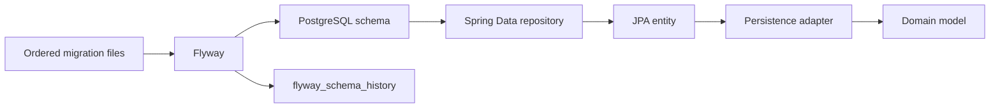

Flyway owns schema evolution. JPA repositories access the resulting tables and hydrate persistence entities. Persistence adapters translate those entities into domain models before application mapping.

Released migrations are append-only. Runtime code must not depend on Hibernate schema generation as the database authority.
